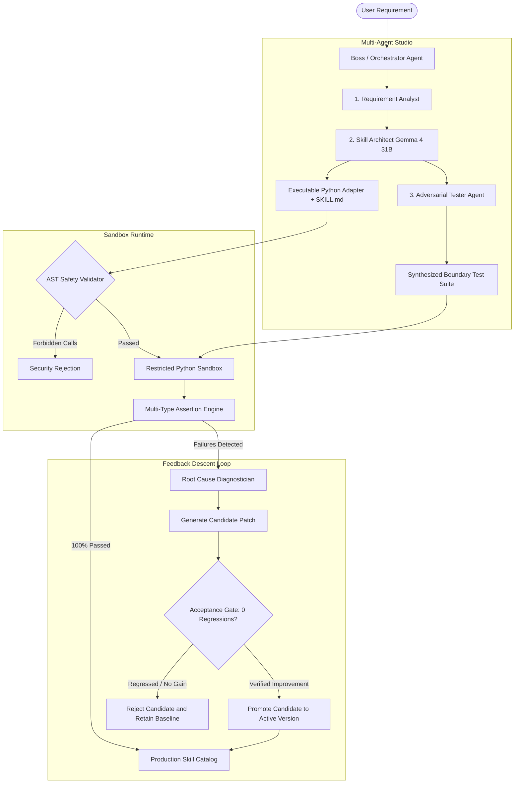

<div align="center">

# ⚡ SkillSmith AI
### Universal Autonomous AI Skill Creation, Execution & Self-Evolution Platform
**Powered by Google Gemma (`gemma4:31b`) on Ollama Cloud**

<br />

[](https://python.org)
[](https://fastapi.tiangolo.com)
[](https://reactjs.org)
[%20via%20Ollama%20Cloud-818cf8.svg?logo=google&logoColor=white)](https://ollama.com)
[](https://github.com/Mannan-Rishi/SkillSmith)
[-success.svg?logo=checkmarx&logoColor=white)](https://github.com/Mannan-Rishi/SkillSmith)
[](SKILLS.md)
[](https://skillsmith-sage.vercel.app)
[](LICENSE)

<br />

> **SkillSmith AI is not a prompt generator or website-testing script.**
> It is an end-to-end autonomous software development platform. Describe any capability in natural language, and SkillSmith will architect a reusable specification (`SKILL.md`), generate executable code, synthesize adversarial boundary tests, execute them inside a hardened AST Python sandbox, diagnose failures via **Feedback Descent**, and autonomously evolve the skill with **zero regressions**.

<br />

[🚀 Quick Start](#-quick-start) •
[🏛️ Architecture](#️-architecture--workflow) •
[🎯 Features](#-core-features) •
[📦 Skills Catalog](#-pre-built-skills-catalog) •
[🔒 Security](#-security--sandbox-isolation) •
[🧪 Testing](#-verification--test-suite) •
[🌐 Live Demo](#-deploy-to-vercel)

</div>

---

## 🌟 Why SkillSmith AI?

Most AI agent frameworks generate code that **looks plausible on screen but fails silently when executed**. SkillSmith AI bridges the gap between **generation** and **verified execution**:

| Problem | SkillSmith's Solution |
|:---|:---|
| 🚫 Generated code crashes at runtime | ✅ **Evidence-Driven Verification** — every skill is executed against adversarial test suites, measuring exact outputs, CPU latencies, and assertion proofs |
| 🚫 No way to know if a "fix" broke something else | ✅ **Zero-Regression Gate** — candidate code is tested against the baseline suite; if even a single previously passing test regresses, the candidate is **instantly rejected** |
| 🚫 Generated code can access the host system | ✅ **AST-Guarded Sandbox** — strict import/function whitelist, 3-second hard timeout, captured stdout/stderr, no filesystem or network access |
| 🚫 Limited to one domain | ✅ **Universal Domain Flexibility** — PII masking, data quality audits, static code analysis, fact-checking, study notes, text mining, and more |

---

## 🏛️ Architecture & Workflow

SkillSmith operates as a **multi-agent pipeline** where each stage is handled by a specialized AI agent:



### How It Works — Step by Step

| Step | Agent | What Happens |
|:---:|:---|:---|
| **1** | **Requirement Analyst** | Decomposes natural language into a precise JSON specification with inputs, outputs, constraints, and acceptance criteria |
| **2** | **Skill Architect** | Designs the `SKILL.md` standard document and generates a pure Python `execute(inputs: dict) -> dict` function |
| **3** | **Adversarial Tester** | Synthesizes 3–5 test cases including boundary conditions, edge cases, and adversarial inputs with typed assertions |
| **4** | **Sandbox Runtime** | Validates code via AST inspection, executes in an isolated environment with a 3-second timeout, and captures all outputs |
| **5** | **Assertion Engine** | Evaluates results using type-aware comparators (`equals`, `contains`, `numeric_range`, `regex`, `has_key`, `length`) |
| **6** | **Feedback Descent** | On failure: diagnoses root cause → generates candidate patch → retests → accepts only if 0 regressions and improved pass rate |

---

## 🎯 Core Features

### 1. 🎮 Interactive "Try Skill" Runner

Run any skill directly from the browser with custom inputs:

- **Schema-Aware JSON Input Editor** — paste or type any valid JSON matching the skill's input schema
- **Real-Time Execution** — runs inside the restricted Python sandbox with sub-millisecond latency tracking
- **Structured Output Display** — inspect return dictionaries, execution time, stdout logs, and error traces
- **Expected vs. Actual Comparison** — define optional expected outputs and visually audit mismatches
- **1-Click Test Persistence** — save any custom execution as a permanent regression test case with a single click

### 2. 🧬 Autonomous Feedback Descent

The core innovation that makes SkillSmith self-improving:

```
Baseline Test Run (failures detected)
    ↓
Root-Cause Diagnosis (Gemma analyzes assertion traces)
    ↓
Candidate Patch Generation (surgical code fixes)
    ↓
Re-test Against EXACT Baseline Suite
    ↓
┌─────────────────────────────┐
│ Acceptance Gate             │
│ ✅ Pass rate improved?      │
│ ✅ Zero regressions?        │
│ ✅ No previously passing    │
│    test now fails?          │
└─────────────────────────────┘
    ↓                    ↓
ACCEPTED              REJECTED
(promote to active)   (retain last known-good)
```

- **Optional Auto-Evolve on Test Failure** — enable in Settings to automatically trigger repair cycles (disabled by default, bounded iteration limit, never overwrites last known-good version)
- **Full Evolution History** — every diagnosis, code change, test result, and accept/reject decision is recorded

### 3. 🔬 Type-Aware Assertion Engine

Supports nested dot-path and array-path lookups (`missing_values.age`, `claims[0].classification`, `action_items[0].owner`):

| Assertion Type | Description | Example |
|:---|:---|:---|
| `equals` | Type-aware equality with whitespace normalization | `expected: 5` matches `actual: 5` |
| `contains` | Substring, list element, or nested dict inspection | `expected: "[EMAIL]"` in `"Contact [EMAIL] for info"` |
| `numeric_range` | Bounds verification, rejects booleans, handles collection lengths | `expected: [0, 100]` for percentage values |
| `length` | Exact or bounded collection/string length | `expected: 3` for a list of 3 items |
| `regex` | Case-insensitive pattern matching | `expected: "\\d{4}-\\d{2}-\\d{2}"` |
| `has_key` | Key presence in dicts or lists of dicts | `expected: "sanitized_text"` |

### 4. 🖥️ Fully Responsive & Stabilized UI

- **Collapsible Test Cards** — smoothly navigate large test suites without page blowout
- **Expandable / Compact Output Viewers** — long JSON outputs default to bounded scrollbars with expand/collapse toggles
- **1-Click Copy** — instant clipboard copying for inputs and outputs
- **Evaluator Error Badges** — visual distinction between assertion failures and runtime exceptions

---

## 🚀 Quick Start

### Prerequisites
- **Python 3.10+**
- **Node.js 18+** & npm
- An [Ollama Cloud](https://ollama.com) account with Gemma access

### 1. Clone & Install

```bash
git clone https://github.com/Mannan-Rishi/SkillSmith.git
cd SkillSmith

# Install backend dependencies
pip install -r requirements.txt

# (Optional) Rebuild frontend if modifying UI source
cd frontend
npm install
npm run build
cd ..
```

### 2. Configure Environment

Create a `.env` file in the project root:

```ini
OLLAMA_API_KEY=your_ollama_api_key_here
OLLAMA_BASE_URL=https://ollama.com/v1
OLLAMA_MODEL=gemma4:31b
HOST=127.0.0.1
PORT=8000
```

> **🔒 Security Note:** Your `OLLAMA_API_KEY` is loaded strictly by the backend server and masked (`180c...-C4z`) in all API responses. It is **never** exposed in client code, frontend bundles, logs, or Git commits.

### 3. Launch

```bash
python run_app.py
```

Open **[http://localhost:8000](http://localhost:8000)** in your browser — you'll see the full SkillSmith dashboard with all 14 pre-built skills ready to explore.

---

## 📦 Pre-Built Skills Catalog

SkillSmith ships with **14 pre-built, fully verified skills** achieving a **100% test pass rate** across all 63 test cases:

| Skill Name | Category | Version | Strategy | Pass Rate | Specification |
|:---|:---|:---:|:---:|:---:|:---:|
| **AI Study Notes Analyzer** | Education & Productivity | `v1.0.1` | `restricted_python` | **100% (4/4)** | [`SKILL.md`](skills/study-notes-exam-prep-assistant/SKILL.md) |
| **Python Code Bug Detector** | Developer Tools | `v1.0.1` | `restricted_python` | **100% (5/5)** | [`SKILL.md`](skills/python-code-bug-detector-reviewer/SKILL.md) |
| **Python Complexity Analyzer** | Developer Tools | `v1.0.2` | `restricted_python` | **100% (5/5)** | [`SKILL.md`](skills/python-code-complexity-analyzer/SKILL.md) |
| **Meeting Action-Item Extractor** | Productivity | `v1.0.0` | `restricted_python` | **100% (4/4)** | [`SKILL.md`](skills/meeting-task-action-item-extractor/SKILL.md) |
| **Email Quality Reviewer** | Communication | `v1.0.1` | `restricted_python` | **100% (4/4)** | [`SKILL.md`](skills/email-message-quality-reviewer/SKILL.md) |
| **AI Research & Fact-Checker** | Research & Verification | `v1.0.0` | `restricted_python` | **100% (5/5)** | [`SKILL.md`](skills/ai-research-fact-checking-assistant/SKILL.md) |
| **Data Quality Analyzer** | Data Engineering | `v1.0.0` | `restricted_python` | **100% (5/5)** | [`SKILL.md`](skills/data-quality-analyzer/SKILL.md) |
| **PII Masking (PK Phone & Email)** | Security & Privacy | `v1.0.3` | `restricted_python` | **100% (5/5)** | [`SKILL.md`](skills/pii-masking-pk-emails-phones/SKILL.md) |
| **Pakistani Phone Validator** | Telecom Validation | `v1.0.0` | `restricted_python` | **100% (5/5)** | [`SKILL.md`](skills/pakistan-phone-validator-extractor/SKILL.md) |
| **Tabular Data Quality & Outliers** | Data Analysis | `v1.0.0` | `restricted_python` | **100% (3/3)** | [`SKILL.md`](skills/data-quality-detector/SKILL.md) |
| **HTTP Security Header Verifier** | Web Security | `v1.0.0` | `restricted_python` | **100% (3/3)** | [`SKILL.md`](skills/http-security-auditor/SKILL.md) |
| **JSON Validator & Parser** | Data Tools | `v1.0.0` | `restricted_python` | **100% (5/5)** | [`SKILL.md`](skills/json-validator-parser/SKILL.md) |

> 📋 See the full index with detailed descriptions in [`SKILLS.md`](SKILLS.md).

---

## 🔒 Security & Sandbox Isolation

All generated code is treated as **untrusted** and executed in a hardened restricted environment:

| Category | ✅ Permitted | 🚫 Prohibited (Blocked by AST Visitor) |
|:---|:---|:---|
| **Modules** | `math`, `re`, `json`, `datetime`, `collections`, `itertools`, `string`, `typing`, `random`, `decimal`, `fractions`, `ast` *(static parsing only)* | `os`, `sys`, `subprocess`, `socket`, `shutil`, `http`, `urllib`, `requests`, `pickle`, `ctypes`, `pathlib`, `multiprocessing` |
| **Functions** | `len`, `range`, `sum`, `enumerate`, `sorted`, `filter`, `map`, `isinstance`, `zip`, `print` *(captured)* | `open`, `exec`, `eval`, `compile`, `getattr`, `setattr`, `delattr`, `globals`, `locals`, `exit`, `quit` |
| **Timeout** | Hard **3.0-second** execution limit enforced via daemon worker threads | Unbounded / infinite loops |
| **Filesystem** | None — no read or write access | All file operations blocked |
| **Network** | None — no outbound connections | All socket/HTTP operations blocked |

---

## 🧪 Verification & Test Suite

SkillSmith includes a comprehensive regression test suite with **32 tests** covering the entire platform:

```bash
# Run the full automated test suite
python -m unittest discover tests
```

```text
................................
----------------------------------------------------------------------
Ran 32 tests in 4.470s

OK
```

### Test Coverage Breakdown

| Test Module | Tests | What It Covers |
|:---|:---:|:---|
| `test_pipeline.py` | 9 | Masked key redaction, security attack blocking, sandbox execution, basic assertion engine |
| `test_features.py` | 11 | "Try Skill" runner, expected-output comparison, test-case saving, settings persistence, candidate evolution gate |
| `test_audit_repairs.py` | 12 | Static AST import validation, timeout enforcement, nested JSON path lookups, collection size comparisons, Study Notes extraction, Complexity Analyzer, Bug Detector PEP 8 |

---

## 🌐 Deploy to Vercel

SkillSmith is **production-ready** and can be deployed to Vercel as a serverless application:

### Step 1 — Import the Repository
Go to [vercel.com](https://vercel.com) → **Add New Project** → **Import Git Repository** → Select `Mannan-Rishi/SkillSmith`

### Step 2 — Add Environment Variables
In **Project Settings → Environment Variables**, add:

| Variable | Value | Visibility |
|:---|:---|:---|
| `OLLAMA_API_KEY` | `your_ollama_api_key_here` | **Encrypted** (server-side only) |
| `OLLAMA_BASE_URL` | `https://ollama.com/v1` | Server-side |
| `OLLAMA_MODEL` | `gemma4:31b` | Server-side |

### Step 3 — Deploy
Click **Deploy**. Vercel will automatically:
- Build the React/Vite frontend from `frontend/`
- Deploy the FastAPI backend as a serverless Python function via `api/index.py`
- Handle routing between the static frontend and API endpoints

### Step 4 — Verify
Visit your deployment URL. The **Settings** page should show ✅ **Verified** for the Ollama Cloud connection.

> 🔗 **Live Demo:** [skillsmith-sage.vercel.app](https://skillsmith-sage.vercel.app)

---

## 📂 Project Structure

```text
SkillSmith/
├── api/
│   └── index.py                   # Vercel serverless entry point
├── backend/
│   ├── executors/
│   │   ├── evaluator.py           # Type-aware assertion & JSON path engine
│   │   └── restricted_python.py   # Hardened AST Python sandbox & timeout runner
│   ├── config.py                  # Safe environment loader & key masking
│   ├── llm_client.py              # Ollama Cloud / Gemma client with JSON repair
│   ├── main.py                    # FastAPI application & REST endpoints
│   ├── models.py                  # Pydantic schemas (Skills, TestCases, Runs)
│   ├── orchestrator.py            # Multi-agent orchestrator & Feedback Descent
│   ├── registry.py                # Skill & settings persistence layer
│   └── seed_data.py               # Initial skill catalog definitions
├── data/
│   ├── settings.json              # Global application settings
│   └── skills/                    # Persistent JSON skill manifests & versions
├── frontend/
│   ├── src/
│   │   ├── components/            # TestingLab, Studio, SkillDetail, Settings
│   │   ├── api.ts                 # Type-safe API client
│   │   ├── types.ts               # TypeScript domain interfaces
│   │   └── index.css              # Responsive theme styling & layout rules
│   └── dist/                      # Compiled production static bundle
├── skills/                        # Exported standalone SKILL.md specifications
├── tests/                         # 32 unit and regression tests
├── requirements.txt               # Backend dependencies
├── vercel.json                    # Vercel deployment configuration
├── package.json                   # Root build script for Vercel
├── run_app.py                     # Unified single-command local launcher
├── SKILLS.md                      # Master catalog of verified skills
└── LICENSE                        # MIT License
```

---

## 🤝 Contributing

Contributions are welcome! Whether creating new skill specifications, adding assertion evaluators, or enhancing sandboxing runtimes:

1. **Fork** the project
2. **Create** your feature branch (`git checkout -b feature/AmazingSkill`)
3. **Implement** your changes and add tests
4. **Run** the test suite — all 32 tests must pass (`python -m unittest discover tests`)
5. **Commit** your changes (`git commit -m 'Add AmazingSkill with tests'`)
6. **Push** to the branch (`git push origin feature/AmazingSkill`)
7. **Open** a Pull Request

---

## 📄 License

Distributed under the **MIT License**. See [`LICENSE`](LICENSE) for more information.

---

<div align="center">

### ⭐ Star this repo if you find it useful!

<br />

<sub>Built with ❤️ by <a href="https://github.com/Mannan-Rishi">Mannan-Rishi</a> using Google Gemma & Ollama Cloud</sub>

<br />

<sub>🛡️ All generated code is sandboxed • 🧬 Self-evolving with zero regressions • 🧪 100% test pass rate</sub>

</div>
