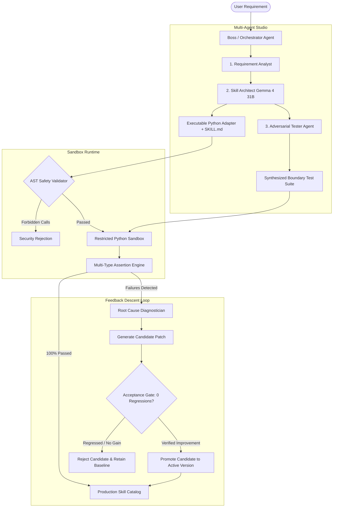

<div align="center">

# ⚡ SkillSmith AI
### Universal Autonomous AI Skill Creation, Execution & Self-Evolution Platform
**Powered by Google Gemma (`gemma4:31b`) on Ollama Cloud**

[](https://python.org)
[](https://fastapi.tiangolo.com)
[](https://reactjs.org)
[%20via%20Ollama%20Cloud-818cf8.svg?logo=ollama&logoColor=white)](https://ollama.com)
[](https://github.com/Mannan-Rishi/SkillSmith)
[-success.svg)](https://github.com/Mannan-Rishi/SkillSmith)
[](LICENSE)

<br />

> **SkillSmith AI is not a prompt generator or website-testing script.**  
> It is an end-to-end autonomous software development platform. Describe any capability in natural language, and SkillSmith will architect a reusable specification (`SKILL.md`), generate executable code, synthesize adversarial boundary tests, execute them inside a hardened AST Python sandbox, diagnose failures via **Feedback Descent**, and autonomously evolve the skill with **zero regressions**.

[Quick Start](#-quick-start) • [Architecture](#-architecture--workflow) • [Key Features](#-core-features) • [Pre-Built Skills](#-pre-built-skills-catalog) • [Security Sandbox](#-security--sandbox-isolation) • [Testing](#-verification--test-suite)

</div>

---

## 🌟 Why SkillSmith AI?

Most AI agent frameworks generate code that looks plausible on screen but fails silently when executed. SkillSmith AI bridges the gap between **generation** and **verified execution**:

1. **Evidence-Driven Verification**: Never assumes code works. Every skill is executed against adversarial test suites, measuring exact outputs, CPU latencies, and assertion proofs.
2. **Deterministic Regression Protection**: Candidate code generated by Gemma is tested against the baseline suite. If even a single previously passing test regresses, the candidate is **instantly rejected** and the last known-good version remains active.
3. **AST-Guarded Sandbox**: Executes generated Python logic safely without container overhead while strictly blocking host file system access, network sockets, subshell execution, and forbidden builtins.
4. **Universal Domain Flexibility**: Built from the ground up for any computational domain — including PII masking, data quality audits, static code complexity analysis, fact-checking, study note synthesis, and text mining.

---

## 🏛️ Architecture & Workflow



---

## 🎯 Core Features

### 1. Interactive "Try Skill" Runner
- **Schema-Aware JSON Input**: Run skills directly from the UI with custom inputs or load pre-filled test payloads.
- **Latency & Output Profiler**: Inspect structured return dictionaries, sub-millisecond execution times, and stdout logs.
- **Expected-vs-Actual Comparison**: Define optional expected outputs and visually audit mismatches.
- **1-Click Test Persistence**: Instantly save custom runs as permanent regression test cases with a single click.

### 2. Autonomous Feedback Descent
- **Automated Root-Cause Diagnosis**: Gemma analyzes baseline outputs, assertion failure traces, and execution errors.
- **Iterative Repair Loop**: Proposes clean code patches and reruns the exact baseline test suite.
- **Zero-Regression Gate**: Rejects candidate patches that degrade existing test cases.
- **Optional Auto-Evolve on Test Failure**: Enable in Settings or Testing Lab to automatically trigger autonomous repair cycles whenever tests fail.

### 3. Type-Aware Assertion Engine
- Supports nested dot and array path lookups (`missing_values.age`, `claims[0].classification`, `action_items[0].owner`).
- Built-in assertion types:
  - `equals`: Type-aware equality, whitespace normalization, collection size equivalences (`[] == 0`).
  - `contains`: Substring matching, list element search, and nested dictionary inspection.
  - `numeric_range`: Bounds verification rejecting booleans and checking collection lengths safely.
  - `length`: Exact or bounded collection/string length validations.
  - `regex`: Case-insensitive pattern matching.
  - `has_key`: Key presence in dictionaries or lists of dictionaries.

### 4. Fully Responsive & Stabilized UI
- **Collapsible Test Cards**: Smoothly navigate large test suites without page blowout.
- **Expandable / Compact Output Viewers**: Long JSON outputs, study guides, and stack traces default to clean bounded scrollbars with expand/collapse toggles.
- **1-Click Copy**: Instant clipboard copying for inputs and outputs.
- **Evaluator Error Badges**: Visual distinction between assertion failures and runtime/evaluator exceptions.

---

## 🚀 Quick Start

### 1. Prerequisites
- **Python 3.10+**
- **Node.js 18+** & npm
- An [Ollama Cloud](https://ollama.com) account (with Gemma access)

### 2. Clone & Install
```bash
git clone https://github.com/Mannan-Rishi/SkillSmith.git
cd SkillSmith

# Install backend dependencies
pip install -r requirements.txt

# (Optional) Rebuild frontend if modifying UI source
cd frontend
npm install
npm run build
cd ..
```

### 3. Configure `.env`
Create a `.env` file in the project root:
```ini
OLLAMA_API_KEY=your_ollama_api_key_here
OLLAMA_BASE_URL=https://ollama.com/v1
OLLAMA_MODEL=gemma4:31b
HOST=127.0.0.1
PORT=8000
```
> **Security Note:** Your `OLLAMA_API_KEY` is loaded strictly by the backend server and masked (`180c...-C4z`) in all responses. It is never exposed in client code, logs, or commits.

### 4. Run Application
```bash
python run_app.py
```
Open **[http://localhost:8000](http://localhost:8000)** in your browser.

---

## 📦 Pre-Built Skills Catalog

SkillSmith ships with **14 pre-built, verified skills** achieving a **100% test pass rate** (63/63 test cases passing):

| Skill Name | Category | Version | Strategy | Pass Rate | Specification |
| :--- | :--- | :---: | :---: | :---: | :---: |
| **AI Study Notes Analyzer** | Education & Productivity | `v1.0.1` | `restricted_python` | **100% (4/4)** | [`skills/study-notes-exam-prep-assistant`](skills/study-notes-exam-prep-assistant/SKILL.md) |
| **Python Code Bug Detector** | Developer Tools | `v1.0.1` | `restricted_python` | **100% (5/5)** | [`skills/python-code-bug-detector-reviewer`](skills/python-code-bug-detector-reviewer/SKILL.md) |
| **Python Complexity Analyzer** | Developer Tools | `v1.0.2` | `restricted_python` | **100% (5/5)** | [`skills/python-code-complexity-analyzer`](skills/python-code-complexity-analyzer/SKILL.md) |
| **Meeting Action-Item Extractor** | Productivity | `v1.0.0` | `restricted_python` | **100% (4/4)** | [`skills/meeting-task-action-item-extractor`](skills/meeting-task-action-item-extractor/SKILL.md) |
| **Email Quality Reviewer** | Communication | `v1.0.1` | `restricted_python` | **100% (4/4)** | [`skills/email-message-quality-reviewer`](skills/email-message-quality-reviewer/SKILL.md) |
| **AI Research & Fact-Checker** | Research & Verification | `v1.0.0` | `restricted_python` | **100% (5/5)** | [`skills/ai-research-fact-checking-assistant`](skills/ai-research-fact-checking-assistant/SKILL.md) |
| **Data Quality Analyzer** | Data Engineering | `v1.0.0` | `restricted_python` | **100% (5/5)** | [`skills/data-quality-analyzer`](skills/data-quality-analyzer/SKILL.md) |
| **PII Masking (Pakistani Phone & Email)** | Security & Privacy | `v1.0.3` | `restricted_python` | **100% (5/5)** | [`skills/pii-masking-pk-emails-phones`](skills/pii-masking-pk-emails-phones/SKILL.md) |
| **Pakistani Phone Validator** | Telecom Validation | `v1.0.0` | `restricted_python` | **100% (5/5)** | [`skills/pakistan-phone-validator-extractor`](skills/pakistan-phone-validator-extractor/SKILL.md) |
| **Tabular Data Quality & Outliers** | Data Analysis | `v1.0.0` | `restricted_python` | **100% (3/3)** | [`skills/data-quality-detector`](skills/data-quality-detector/SKILL.md) |
| **HTTP Security Header Verifier** | Web Security | `v1.0.0` | `restricted_python` | **100% (3/3)** | [`skills/http-security-auditor`](skills/http-security-auditor/SKILL.md) |
| **JSON Validator & Parser** | Data Tools | `v1.0.0` | `restricted_python` | **100% (5/5)** | [`skills/json-validator-parser`](skills/json-validator-parser/SKILL.md) |

*(See full index in [`SKILLS.md`](SKILLS.md)).*

---

## 🔒 Security & Sandbox Isolation

Generated code is treated as untrusted and executed in a restricted environment:

| Category | Permitted | Prohibited (Blocked by AST Visitor) |
| :--- | :--- | :--- |
| **Modules** | `math`, `re`, `json`, `datetime`, `collections`, `itertools`, `string`, `typing`, `random`, `decimal`, `fractions`, `ast` *(static parsing only)* | `os`, `sys`, `subprocess`, `socket`, `shutil`, `http`, `urllib`, `requests`, `pickle`, `ctypes`, `pathlib`, `multiprocessing` |
| **Functions** | `len`, `range`, `sum`, `enumerate`, `sorted`, `filter`, `map`, `isinstance`, `zip`, `print` *(captured)* | `open`, `exec`, `eval`, `compile`, `getattr`, `setattr`, `delattr`, `globals`, `locals`, `exit`, `quit` |
| **Timeout** | Hard **3.0-second** execution limit enforced via daemon worker threads to prevent infinite loops | Unbounded processing |

---

## 🧪 Verification & Test Suite

SkillSmith AI includes a comprehensive regression test suite:

```bash
# Run full automated test suite (32 tests)
python -m unittest discover tests
```

```text
Ran 32 tests in 4.470s
OK
```

### Coverage Highlights
- `test_pipeline.py`: Masked key redaction, security attack blocking, basic assertions.
- `test_features.py`: "Try Skill" runner, expected-output comparator, test-case saving, settings persistence, candidate evaluation gate.
- `test_audit_repairs.py`: Static AST imports, timeout enforcement, nested JSON paths, collection size comparisons, Study Notes extraction, Complexity Analyzer auxiliary space, and Bug Detector PEP 8 separation.

---

## 📂 Project Structure

```text
SkillSmith/
├── backend/
│   ├── executors/
│   │   ├── evaluator.py          # Type-aware assertion & JSON path engine
│   │   └── restricted_python.py  # Hardened AST Python sandbox & timeout runner
│   ├── config.py                 # Safe environment loader & key masking
│   ├── llm_client.py             # Ollama Cloud / Gemma client with JSON repair
│   ├── main.py                   # FastAPI application & REST endpoints
│   ├── models.py                 # Pydantic schemas (Skills, TestCases, Runs)
│   ├── orchestrator.py           # Multi-agent orchestrator & Feedback Descent
│   ├── registry.py               # Skill & settings persistence layer
│   └── seed_data.py              # Initial skill catalog definitions
├── data/
│   ├── settings.json             # Global application settings
│   └── skills/                   # Persistent JSON skill manifests & versions
├── frontend/
│   ├── src/
│   │   ├── components/           # TestingLab, Studio, SkillDetail, Settings
│   │   ├── api.ts                # Type-safe API client
│   │   ├── types.ts              # TypeScript domain interfaces
│   │   └── index.css             # Responsive theme styling & layout rules
│   └── dist/                     # Compiled production static bundle
├── skills/                       # Exported standalone SKILL.md specifications
├── tests/                        # 32 unit and regression tests
├── requirements.txt              # Pinned backend dependencies
├── run_app.py                    # Unified single-command launcher
└── SKILLS.md                     # Master catalog of verified skills
```

---

## 🤝 Contributing

Contributions are welcome! Whether creating new skill specifications, adding assertion evaluators, or enhancing sandboxing runtimes:

1. Fork the Project
2. Create your Feature Branch (`git checkout -b feature/AmazingSkill`)
3. Commit your Changes (`git commit -m 'Add AmazingSkill'`)
4. Push to the Branch (`git push origin feature/AmazingSkill`)
5. Open a Pull Request

---

## 📄 License

Distributed under the **MIT License**. See `LICENSE` for more information.

<div align="center">
  <sub>Built with ❤️ by <a href="https://github.com/Mannan-Rishi">Mannan-Rishi</a> using Google Gemma & Ollama Cloud.</sub>
</div>
